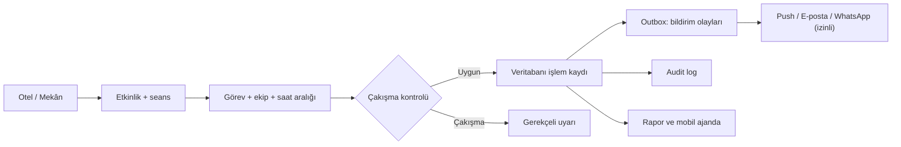

# Etkinlik takip sistemleri: doğrulanmış yetenekler ve mimari

**İnceleme tarihi:** 2026-11-01. **Yöntem:** Resmî geliştirici
dokümanları, açık kaynak ve REA ile herkese açık tarayıcı gözlemi.
Satıcıların kapalı üretim kodu ve iç servisleri görülmedi.

## Kanıt tablosu

| Ürün | Doğrulanan iş akışı | Kanıt | Dikkat |
| --- | --- | --- | --- |
| pretix | Etkinlik → bilet/satış kotası → sipariş → check-in → webhook | https://docs.pretix.eu/dev/api/ ve https://docs.pretix.eu/dev/api/webhooks.html | Yinelenen webhook teslimi mümkün, idempotency gerekli. |
| Eventbrite | Etkinlik/mekân/bilet → sipariş/katılımcı → check-in olayları | https://www.eventbrite.co.uk/platform/docs/webhooks | API erişimi kimlik doğrulamalı. |
| Whova | Etkinlik/gün/oturum seçimi → QR veya adla check-in | https://whova.zendesk.com/hc/en-us/articles/360020638492-Can-I-use-the-App-to-check-in-attendees | İç teknoloji yığını gözlenmedi. |
| Cvent | Etkinlik verilerini CRM ve pazarlama sistemleriyle eşitleme | https://www.cvent.com/en/event-management-software/cvent-integrations | Entegrasyon imkânı API şartlarına bağlı. |
| EVENTRA | Otel → etkinlik → grup/personel görevi → ajanda, gider, bildirim | https://github.com/aliihaydargenc-dotcom/bevisionevent | Kendi repo koduna ve README'ye dayalı. |

## REA bulguları

Kayıtlar `data/rea-evidence.json` içindedir; her biri tanımlı Edge
tarayıcı senaryosunun gerçek Evidence kimliğine bağlanır.

- **pretix.eu**: https://pretix.eu/ URL'si /about/en/ sayfasına
  yönlendi. `static.pretix.cloud` üzerinden paketlenmiş JS ve CSS
  gözlendi. Bu, halka açık tanıtım sayfasının istemci kaynaklarıdır.
  Backend kodunu pretix'in açık kaynak deposu ve resmî API şeması
  doğrular; tanıtım sitesinin network izi doğrulamaz.
- **eventbrite.com**: Ana sayfada `/home/api/search/`,
  `/home/api/nearby_cities/` ve `/consumer-header/api/user`
  istek yolları; Next.js ile uyumlu `data-next-head` işaretleri
  gözlendi. Bu yalnızca **genel ana sayfa** ile ilgilidir.
  Gizli organizatör panelinin JS çerçevesi, veritabanı, ticketing
  servisi veya çalışma ölçeği hakkında kanıt değildir.

## Çalışma mantığı için önerilen kendi mimarimiz

Teklif edilen tablo ayrımı:
`events` (etkinlik), `event_sessions` (tarihler),
`assignments` (grup, personel, hareket/sahne/dönüş),
`venues`, `cost_entries`, `notification_outbox`,
`delivery_attempts`, `audit_logs`, `tenants`.
Her tenant tablosunda `tenant_id` ve veritabanı düzeyinde
erişim kontrolü gerekir. Görev durumu ayrı bir durum makinesi
(taslak → planlandı → teyit edildi → tamamlandı/iptal) olmalıdır.

**Takvim güvenilirliği:** Personel/grup çakışması için yalnızca
sahne zamanı değil hareket ve dönüş aralığına bakılmalı; veritabanı
işleminde tekrar kontrol edilmelidir. İstemcideki ön kontrol tek başına
yeterli değildir. Kullanıcı saat dilimi ve yerel gün sınırları
sunucuya açıkça iletilir.

**Bildirim güvenilirliği:** Değişiklik işlemi ile outbox kaydı aynı
veritabanı transaction'ında yazılır. Worker tekrar deneyebilir;
idempotency anahtarı `tenant_id + event_id + version + channel`.
Webhooks sadece olayı tetiklemek için alınır, doğrulanmış API'den
güncel kayıt tekrar okunur (pretix yaklaşımı).

**Mobil operasyon:** Masaüstünde kapasite ve kârlılık panelleri;
mobilde 'Bugün, Bana Atananlar, Değişiklikler, Otel Bilgisi' öncelikli.
Tek tıkla teyit, hızlı kişi arama, gerektiğinde internetsiz durum
mesajı, izinli bildirim. Sürükleme davranışına buton/klavye alternatifi.

## Teknoloji değerlendirmesi

| Bileşen | Öneri | Kanıt / gerekçe |
| --- | --- | --- |
| UI | Next.js + React + TypeScript | EVENTRA mevcut kodu ve testli veri modelleriyle uyum |
| API | Next route handlers veya ayrı FastAPI | Tek deploy kolaylığına / ağır worker gereksinimine göre |
| DB | PostgreSQL | Eşzamanlılık, transaction, audit, tenant izolasyonu |
| Yetki | Better Auth + sunucu kontrolleri | EVENTRA'nın mevcut kütüphanesi; rolleri tek başına UI'da koruma sayma |
| Bildirim | DB outbox + scheduler + Web Push | Tekrarlanabilir, gözlenebilir teslim |
| Arayüz hareketi | Motion (hafif, azaltılmış hareket destekli) | EVENTRA bağımlılıkları; görev akışına hizmet etmeli |
| Takvim | Erişilebilir gün/hafta/ay gridi | Davranışsal tercih; rakibin gizli kodundan türetilmedi |

Bu tablo "en çok kullanılan teknoloji" pazar payı ölçümü değildir;
burada o iddiayı sağlayacak bağımsız istatistik bulunmuyor.
